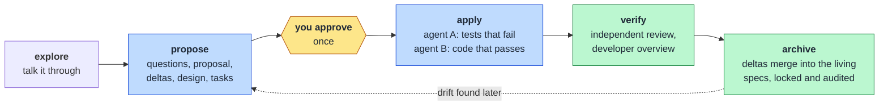
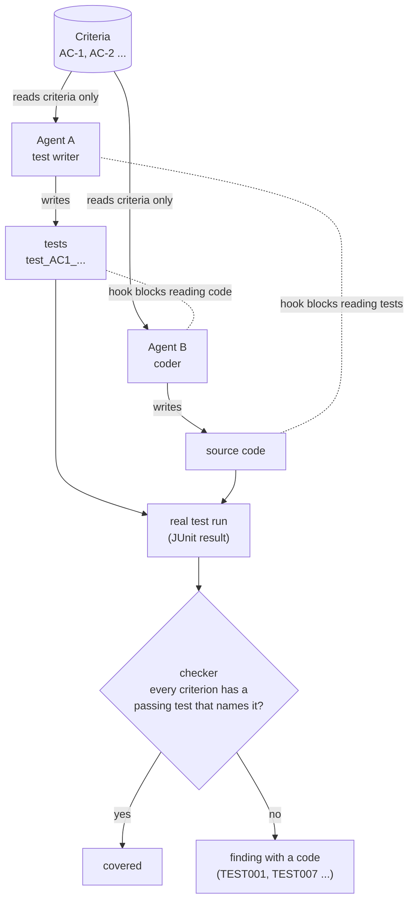
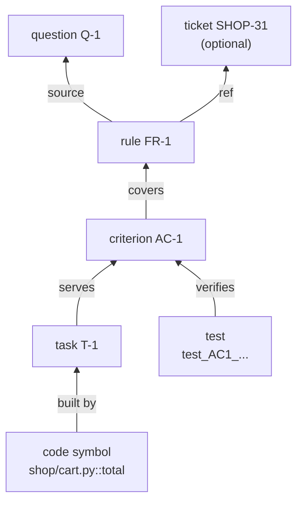
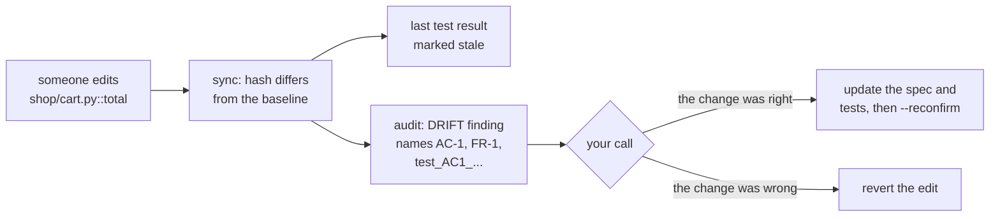

# TraceSpec

[](https://github.com/knrl/tracespec/actions/workflows/ci.yml)
[](LICENSE)
[](docs/getting-started.md)

**Traceable spec-driven development for Claude Code.** An automated requirements traceability matrix combined with
acceptance-test-driven development, run by agents.

Every requirement gets acceptance criteria written first. Every test comes from a criterion. Every piece of code comes from a
failing test. A tool, not a model, proves that chain, records it from ticket down to the function, and flags it when code, tests or
specs drift away from it later.



<sub>Yellow is your decision, blue is agent work, green is checked by the tool.</sub>

> **Status: 0.1.0, early.** It works end to end and is tested on Windows and Linux, but the format TraceSpec writes into your project
> may still change before 1.0; the [changelog](CHANGELOG.md) says when it does.

## Why TraceSpec?

- **Agents build against a written contract**, and you get proof afterwards, not "the agent said it works".
- **Tests and code are written by different agents** that never see each other's work (enforced by a hook), so they can only agree
  through the specification.
- **Coverage is decided by a checker** from a real test run: a requirement is covered when an acceptance criterion names it and a
  test carrying that criterion's number ran and passed. The model never gets to say "covered".
- **One decision from you.** You answer questions and approve the proposal once. Everything else is a check that passes, or refuses
  with a reason.
- **It stays true.** After a change ships, edits made outside the process show up as findings that name the rules and tests to revisit.
- **You can ask it things.** "Why does this line exist?", "What was built for ticket X?", "Which tests protect this function?"

## How the pieces fit

The two build agents only meet through the written criteria, and the checker, not a model, decides what counts as covered.



## What it records

Each link in this chain is stored in a small binary trace and can be queried from either end.



## How it compares

The spec-driven space is busy and every tool makes different trade-offs. These are the stated focuses, from each project's own
documentation; check them for what they offer today.

| Tool | Stated focus |
|---|---|
| [Spec Kit](https://github.com/github/spec-kit) | An open-source toolkit and CLI for spec-driven development across many coding agents |
| [OpenSpec](https://github.com/Fission-AI/OpenSpec) | Lightweight, per-change spec workflow with living specs and deltas, through slash commands |
| [Kiro](https://kiro.dev) | An agentic IDE with spec-driven development built in |
| [BMAD-METHOD](https://github.com/bmad-code-org/BMAD-METHOD) | A team of specialised agents following an agile method |
| [Tessl](https://tessl.io) | Treating the spec as the long-lived source of truth |

TraceSpec shares the per-change, spec-first workflow, and borrows its living-spec and delta model from OpenSpec. Its own focus is what
comes after the spec: **independent test and code agents, coverage decided by a checker from real test runs, a queryable trace down to
functions, and an audit for drift after shipping.**

## Quick start

You need [Claude Code](https://claude.com/claude-code) and Python 3.10 or newer. Nothing else is required (`git` and
[universal-ctags](https://ctags.io) are optional).

```bash
git clone https://github.com/knrl/tracespec.git
cd tracespec
python install.py          # skill -> ~/.claude/skills/tracespec, agents -> ~/.claude/agents
```

Or clone straight into the skills folder and install only the agents:

```bash
git clone https://github.com/knrl/tracespec.git ~/.claude/skills/tracespec
python ~/.claude/skills/tracespec/install.py
```

**Restart Claude Code** (skills and agents are read when a session starts), open it in the project you want to change, and type:

```
/tracespec add a 10% discount at checkout for orders over 100
```

You will be asked a few questions, shown a short summary to approve, and then the tests and the code are written, checked and
archived. [Getting started](docs/getting-started.md) walks through every step.

| Verb | What happens |
|---|---|
| `explore <topic>` | Read-only thinking partner. Writes nothing unless you ask. |
| `propose <request>` | Discovers the project (first time), asks questions, writes the change folder, stops for your **one approval**. |
| `apply` | Skeleton, then tests that must fail first (agent A), then code (agent B), task by task. Resumable. |
| `update` | Revises the documents: an amendment, or a new version approved again. |
| `verify` | Converges code against the documents, independent review, writes the developer overview. |
| `archive` | Merges the delta into the living specs, writes the trace baseline and ledger, moves the change to the archive. |
| `audit` | Finds drift in specs, code and tests, and says how to resolve it. |
| `trace <anything>` | Asks the trace how a rule, criterion, test, task, file, symbol or ticket relates to the rest. |

Updating is `git pull` and `python install.py` again.

## Ask the trace

```
/tracespec trace shop/cart.py:6
```
```
^ ref  ref SHOP-31
^ from  question add-discount/Q-1  From what order total does the discount apply? -- Over 10000 cents...
rule FR-1 [checkout]  The total of a cart is the sum of its item prices as a float, before any...
  covers  criterion AC-1 [checkout]  Given item prices 100 and 250, when the cart is totalled, then the total...
    serves  task add-discount/T-1  The float total and the discount
      ==> built by  code shop/cart.py::total  function   <ok>
    verifies  test tests/test_cart.py::test_AC1_total_is_a_float_before_any_discount   <ok>
```

That is real output from [`examples/shop`](examples/shop). Targets can be a rule or criterion ID, a test, a task, a file,
`file::symbol`, `file:line`, a ticket, or a capability; see [Commands](docs/commands.md#--trace).

## Staying true after it ships

The live layer hashes your files and symbols on every command. An edit made outside the process turns into a finding that names what to revisit.



## What lands in your repository

| Where | What | Who reads it |
|---|---|---|
| `.tracespec.json` | State and layout (which paths are tests and code, the test command) | the tool |
| `.tracespec/specs/<capability>/` | The **living specs**, a binary trace baseline (`trace.db`) and a hash-chained ledger (`history.jsonl`) | the tool and the agents |
| `.tracespec/changes/<change>/` | A change in flight: proposal, delta specs, design, tasks. Archived changes move to `changes/archive/`. | the agents |
| `.tracespec/cache/` | Local live layer. Gitignored by its own `.gitignore`. | the tool |
| `docs/features/<change>.md` | **One short overview per feature**: purpose, how it fits the codebase, architecture, key components, data flow | **you** |

Commit `.tracespec/` (the baseline and ledger are what make the audit work in CI) and `docs/features/`. Nobody has to review the files
under `.tracespec/`; your review of a proposal is a summary shown in the chat.

## Documentation

| | |
|---|---|
| [Getting started](docs/getting-started.md) | Install and make your first change |
| [Concepts](docs/concepts.md) | Living specs, deltas, the trace, the audit |
| [Commands](docs/commands.md) | Every verb, flag and finding code |
| [Customization](docs/customization.md) | Layout, stack presets, symbols, references, hooks |
| [Team workflow](docs/team-workflow.md) | Branches, pull requests, CI, merge conflicts |
| [Examples](docs/examples.md) | Real output from a finished project |
| [Troubleshooting](docs/troubleshooting.md), [FAQ](docs/faq.md), [Glossary](docs/glossary.md), [Roadmap](docs/roadmap.md) | |

## Limits

- The checker proves each criterion has a passing test and that the chain is intact. It cannot prove the criteria are the right ones.
- A weak test with the right name passes the checker. The independent review is the only guard against that.
- No call graph: a change in a function does not flag the functions that call it ([roadmap](docs/roadmap.md)).
- A comment edited inside a function changes that function's hash.
- Tamper-evident, not tamper-proof: anyone with write access can rewrite spec, baseline and ledger together.
- Symbols are exact for Python, good with universal-ctags, approximate otherwise. Only the Python stack preset has been exercised.
- Tests are not run automatically (they are slow). A recorded result is marked stale when something it depended on changes.
- Tested on Python 3.10, 3.12, 3.13 and 3.14, on Linux and Windows. macOS is covered by CI only.

## Contributing

Issues and pull requests are welcome; small fixes can go straight to a pull request, anything bigger starts as an issue. Read
[CONTRIBUTING.md](CONTRIBUTING.md) for the design rules (the tool decides, never the model; standard library only) and how to run the
tests. Please follow the [Code of Conduct](CODE_OF_CONDUCT.md). Report vulnerabilities privately, as described in
[SECURITY.md](SECURITY.md). Maintainers are listed in [MAINTAINERS.md](MAINTAINERS.md); agents working on this repository should read
[AGENTS.md](AGENTS.md).

## Acknowledgements

TraceSpec's per-change workflow, living specs and deltas are inspired by [OpenSpec](https://github.com/Fission-AI/OpenSpec) (MIT). The
conduct policy is adapted from the [Contributor Covenant](https://www.contributor-covenant.org), and the changelog follows
[Keep a Changelog](https://keepachangelog.com).

## License

MIT. See [LICENSE](LICENSE).
