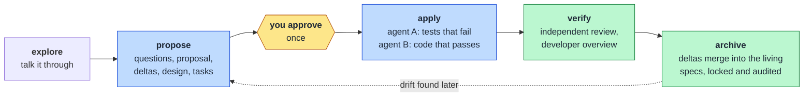

# TraceSpec

[](https://github.com/knrl/tracespec/actions/workflows/ci.yml)
[](LICENSE)
[](docs/getting-started.md)

**Traceable spec-driven development for Claude Code.** An automated requirements traceability matrix combined with
acceptance-test-driven development, run by agents.

You describe a change. Agents write the requirements and acceptance criteria, one agent writes tests that must fail, a different
agent writes the code, and a checker, not a model, proves every requirement is covered by a passing test. Later, edits made outside
the process are flagged as drift.



<sub>Yellow is your decision, blue is agent work, green is checked by the tool.</sub>

> **Status: 0.1.0, early.** It works end to end and is tested on Windows and Linux, but the format TraceSpec writes into your project
> may still change before 1.0; the [changelog](CHANGELOG.md) says when it does.

## Use it in three steps

You need [Claude Code](https://claude.com/claude-code) and Python 3.10 or newer. Nothing else.

**1. Install** (once)

```bash
git clone https://github.com/knrl/tracespec.git
cd tracespec
python install.py
```

Then **restart Claude Code**: skills and agents are read when a session starts.

**2. Ask for a change** in the project you want to change

```
/tracespec add a 10% discount at checkout for orders over 100
```

It asks a few questions, then shows a short summary.

**3. Approve once**

Say yes to the summary. The tests are written (and fail), the code is written (and passes), the checker verifies it, and you get
one short overview of the feature in `docs/features/`. That is the whole loop.

## Cheat sheet

| You type | What happens |
|---|---|
| `/tracespec <request>` | Starts a change: questions, then a proposal for your one approval |
| `/tracespec explore <topic>` | Think it through first. Writes nothing. |
| `/tracespec apply` | Build the approved change: tests first, then code. Resumable. |
| `/tracespec update` | The plan changed: revise the documents |
| `/tracespec verify` | Independent review, writes the developer overview |
| `/tracespec archive` | Merge the change into the living specs |
| `/tracespec audit` | Find code, tests or specs that drifted since |
| `/tracespec trace <anything>` | Ask how a rule, test, file, function or ticket connects to the rest |
| `/tracespec list`, `show <change>`, `view` | See what is in flight |

Most of the time you only type the first line and answer questions; the agent moves through the other verbs itself.

## Ask the trace

```
/tracespec trace shop/cart.py:6
```
```
^ ref  ref SHOP-31
^ from  question add-discount/Q-1  From what order total does the discount apply? -- Over 10000 cents...
rule FR-1 [checkout]  The total of a cart is the sum of its item prices as a float, before any...
  covers  criterion AC-1 [checkout]  Given item prices 100 and 250, when the cart is totalled, then the total...
    serves  task add-discount/T-1  The float total and the discount
      ==> built by  code shop/cart.py::total  function   <ok>
    verifies  test tests/test_cart.py::test_AC1_total_is_a_float_before_any_discount   <ok>
```

That is real output from [`examples/shop`](examples/shop). You can ask about a rule or criterion ID, a test, a task, a file,
`file::symbol`, `file:line`, a ticket, or a whole capability. "Why does this line exist?", "What was built for ticket X?", "Which
tests protect this function?"

## Why TraceSpec?

- **Agents build against a written contract**, and you get proof afterwards, not "the agent said it works".
- **Tests and code come from different agents** that never see each other's work (a hook enforces it), so they can only agree
  through the specification.
- **Coverage is decided by a checker** from a real test run. The model never gets to say "covered".
- **One decision from you.** Answer questions, approve once. Everything else is a check that passes or refuses with a reason.
- **It stays true.** Edits made outside the process show up as findings that name the rules and tests to revisit.

## Learn more

| | |
|---|---|
| [Getting started](docs/getting-started.md) | The same three steps, with every prompt and what you will see |
| [How it works](docs/how-it-works.md) | Diagrams of the agents, the trace and drift, and what lands in your repo |
| [Concepts](docs/concepts.md) | Living specs, deltas, the trace, the audit |
| [Commands](docs/commands.md) | Every verb, flag and finding code |
| [Customization](docs/customization.md) | Layout, stack presets, symbols, external ticket references, hooks |
| [Team workflow](docs/team-workflow.md) | Branches, pull requests, CI, merge conflicts |
| [Examples](docs/examples.md) | Real output from a finished project |
| [Comparison and limits](docs/comparison-and-limits.md) | How it differs from OpenSpec, Spec Kit and others; what it cannot do |
| [Troubleshooting](docs/troubleshooting.md), [FAQ](docs/faq.md), [Glossary](docs/glossary.md), [Roadmap](docs/roadmap.md) | |

Updating is `git pull` and `python install.py` again.

## Contributing

Issues and pull requests are welcome; small fixes can go straight to a pull request, anything bigger starts as an issue. Read
[CONTRIBUTING.md](CONTRIBUTING.md) for the design rules and how to run the tests. Please follow the
[Code of Conduct](CODE_OF_CONDUCT.md). Report vulnerabilities privately, as described in [SECURITY.md](SECURITY.md). Maintainers are
listed in [MAINTAINERS.md](MAINTAINERS.md); agents working on this repository should read [AGENTS.md](AGENTS.md).

## Acknowledgements

TraceSpec's per-change workflow, living specs and deltas are inspired by [OpenSpec](https://github.com/Fission-AI/OpenSpec) (MIT). The
conduct policy is adapted from the [Contributor Covenant](https://www.contributor-covenant.org), and the changelog follows
[Keep a Changelog](https://keepachangelog.com).

## License

MIT. See [LICENSE](LICENSE).
