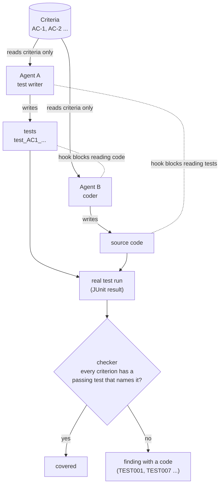
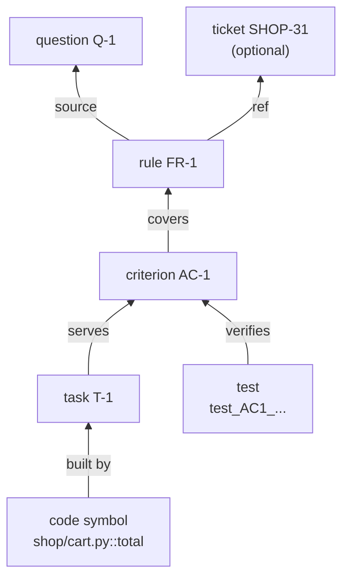
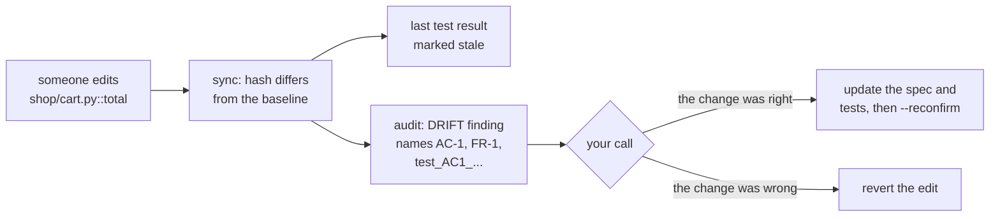

# How it works

The picture behind the quick start: who does what, what gets recorded, and what happens when something changes later. For the
vocabulary, see [Concepts](concepts.md); for every command, see [Commands](commands.md).

## How the pieces fit

The two build agents only meet through the written criteria, and the checker, not a model, decides what counts as covered.

## What it records

Each link in this chain is stored in a small binary trace and can be queried from either end with `/tracespec trace`.

## Staying true after it ships

The live layer hashes your files and symbols on every command. An edit made outside the process turns into a finding that names
what to revisit.

## What lands in your repository

| Where | What | Who reads it |
|---|---|---|
| `.tracespec.json` | State and layout (which paths are tests and code, the test command) | the tool |
| `.tracespec/specs/<capability>/` | The **living specs**, a binary trace baseline (`trace.db`) and a hash-chained ledger (`history.jsonl`) | the tool and the agents |
| `.tracespec/changes/<change>/` | A change in flight: proposal, delta specs, design, tasks. Archived changes move to `changes/archive/`. | the agents |
| `.tracespec/cache/` | Local live layer. Gitignored by its own `.gitignore`. | the tool |
| `docs/features/<change>.md` | **One short overview per feature**: purpose, how it fits the codebase, architecture, key components, data flow | **you** |

Commit `.tracespec/` (the baseline and ledger are what make the audit work in CI) and `docs/features/`. Nobody has to review the
files under `.tracespec/`; your review of a proposal is a summary shown in the chat.
