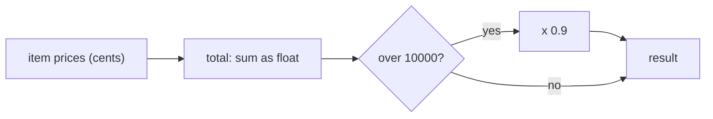

# Add a discount

> Developer overview: read this to understand the feature without opening the agent files in `.tracespec/`. Keep it short.

## Purpose

Larger orders should cost less, and gift cards are moving to the payments service. This change gives orders over 100.00 a 10% discount
and removes gift card handling from the cart.

## Design

Only `shop/cart.py` changes. `total` now returns a float and applies the discount inside itself, so it can only be applied once:

`accept_gift` is gone: callers must use the payments service (`payments.accept_gift`) instead. The catalogue is untouched.

Key decision: the threshold is a module constant, `DISCOUNT_THRESHOLD`, not a parameter, because every caller wants the same rule. If
tiers are ever needed, that constant becomes a table.

## Key components

| Component | Path | Responsibility |
|---|---|---|
| Cart pricing | `shop/cart.py` | Totals item prices and applies the 10% discount over the threshold |
